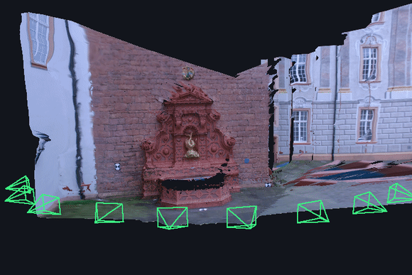
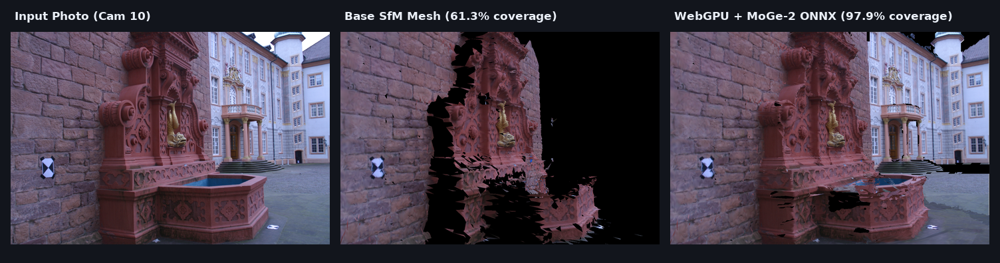

# 3d_reconstruction

An end-to-end 3D Structure-from-Motion (SfM), textured surface meshing, WebGPU compute-accelerated, neural 3D Transformer hole-completion, and interactive OpenGL camera-viewer pipeline written in Zig.


*Reconstructed `fountain-p11` mesh (`934,393` vertices / `1,795,088` triangles) with all 11 recovered camera frustums (green) and MoGe-2 neural hole completion.*

## Overview

Starting from a calibrated multi-view photo collection (`K.txt` + images), **`3d_reconstruction`** reconstructs camera poses, a sparse 3D point cloud, and a completed, photo-textured triangle mesh exported to ASCII `.ply`:

1. **Multi-Scale Feature Extraction & Matching ([`src/features.zig`](src/features.zig), [`src/gpu.zig`](src/gpu.zig))**
   - Tiled Harris corner detection (`detectAndCompute`) and binary descriptor matching.
   - Optional `--gpu` acceleration offloading Harris scoring and batched descriptor distance matrices to WebGPU compute shaders (`wgpu-native`).
2. **Incremental Structure-from-Motion ([`src/pipeline.zig`](src/pipeline.zig), [`src/epipolar.zig`](src/epipolar.zig), [`src/triangulation.zig`](src/triangulation.zig), [`src/pnp.zig`](src/pnp.zig), [`src/bundle_adjust.zig`](src/bundle_adjust.zig))**
   - Two-view essential matrix initialization, iterative PnP RANSAC registration, DLT triangulation, and SE(3) Levenberg-Marquardt / Gauss-Newton bundle adjustment.
3. **Surface Meshing & Photometric Completion ([`src/mesh.zig`](src/mesh.zig))**
   - View-consistent Delaunay meshing (`buildColoredMesh`), multi-view photo-verified edge bridging (`completeMeshWithPhotoVerify`), interior boundary-loop triangulation (`fillMeshInteriorHoles`), and Z-buffered multi-view texture subdivision (`subdivideAndProjectTexture`).
4. **Optional 3D Transformer Hole Completion ([`src/neural_depth.zig`](src/neural_depth.zig))**
   - Optional `--nn-model <onnx>` pass using native bindings to **ONNX Runtime** (`c_ort.h`) supporting **MoGe-2 ViT-B** (`moge-2-vitb-normal.onnx`), **Depth Anything 2 Base** (`depth-anything-v2-base.onnx`), and **Depth Anything 3 Base** (`depth-anything-v3-base/model.onnx`).
   - Schedules viewpoints widest-hole-first, aligns both direct depth (`+Z`, via `fitAffineDepthWeightedIrlS` / `fitMonotoneQuadDepthWeightedIrlS`) and relative inverse disparity (`1/Z`, via `fitDisparityDepthWeightedIrlS`) to SfM scale across 16 log-depth octave bins, and stitches hole surfaces on a regular grid with silhouette depth-jump guards.
5. **Photometric Verification & Interactive Viewer ([`src/render.zig`](src/render.zig), [`src/viewer.zig`](src/viewer.zig), [`src/viewer_math.zig`](src/viewer_math.zig))**
   - `--verify-views <dir>` renders each registered camera, held-out view, and interpolated novel viewpoint with Coverage, MAE, RMSE, PSNR, and SSIM reports.
   - Standalone OpenGL + GLFW viewer (`sfm_viewer`) with Free Orbit mode and click-to-enter **First-Person Camera mode** aligned to any reconstructed camera's pose, intrinsics FOV, look rotation, local displacement, photo PiP reference, and aligned photo overlay.

## Requirements

- **Zig** `>= 0.17.1`
- **System C libraries** (linked in [`build.zig`](build.zig)):
  - `libpng`, `libjpeg`
  - `glfw`, `GL`, `X11` (for `sfm_viewer`)
- **In-project native runtimes** (binary `.so`/`.onnx` artifacts are excluded from Git via [`.gitignore`](.gitignore)):
  - [`third_party/wgpu-native/`](third_party/wgpu-native) (`v27.0.4.0` headers + shared library under `third_party/wgpu-native/lib/`)
  - [`third_party/onnxruntime/`](third_party/onnxruntime) (`v1.22.0` headers tracked + `libonnxruntime.so` under `third_party/onnxruntime/lib/`)
  - Optional ONNX models in `models/` for `--nn-model` (`depth-anything-v2-base.onnx`, `depth-anything-v3-base/model.onnx`, or `moge-2-vitb-normal.onnx`)

## Building & Testing

```bash
# Run all unit and integration tests
zig build test --summary all

# Build release binaries (zig-out/bin/3d_reconstruction and zig-out/bin/sfm_viewer)
zig build -Doptimize=ReleaseFast
```

## Usage

### Reconstruction CLI (`3d_reconstruction`)

```bash
./zig-out/bin/3d_reconstruction \
  --data data/fountain-p11 \
  --threads 8 \
  --gpu \
  --nn-model models/moge-2-vitb-normal.onnx \
  --out output/fountain_nn.ply \
  --verify-views output/views_nn
```

| Flag | Default | Description |
| --- | --- | --- |
| `--data <dir>` | `data/fountain-p11` | Input directory containing `K.txt` and images (`.png`, `.jpg`, `.jpeg`) |
| `--out <ply>` | `output/reconstruction.ply` | Output ASCII `.ply` mesh with camera metadata |
| `--max-dim <px>` | `1200` | Downscale longest image edge to `<px>` before SfM |
| `--threads <n>` | `1` | Worker threads for SfM and ONNX Runtime intra-op execution |
| `--gpu` | `false` | Enable WebGPU compute acceleration for feature detection and matching |
| `--nn-model <onnx>` | *none* | Path to local ONNX 3D Transformer depth model for hole completion |
| `--verify-views <dir>` | *none* | Render real/virtual/holdout/novel `.ppm` views and print PSNR/SSIM/coverage |

### Interactive 3D & Camera Viewer (`sfm_viewer`)

```bash
./zig-out/bin/sfm_viewer output/fountain_nn.ply
```

- **Click any green camera frustum or top bar number (`00`..`N`)**: Smoothly transition into that camera's **First-Person View Model** (`exact pose`, intrinsics FOV, and orientation).
- **Left-drag**: Orbit around scene target (Free Orbit) or look around in place from the camera center (Camera View).
- **Right-drag / `Shift` + Left-drag**: Pan in the active camera plane.
- **`W`/`A`/`S`/`D`/`Q`/`E` & Scroll Wheel**: Displace forward/backward, strafe, and move up/down along the active camera's rotated axes (or translate target / zoom in Free Orbit).
- **`Left`/`Right` Arrows**: Step between reconstructed cameras.
- **`R`**: Cycle aligned real photo overlay (`OFF` / `50%` / `100%`).
- **`P`**: Toggle Picture-in-Picture reference photo thumbnail.
- **`F` / `Esc` / `FREE ORBIT (F)`**: Return smoothly to Free Orbit mode.

## Benchmark Snapshot (`fountain-p11`, 11 x `1200x800` images, `-Doptimize=ReleaseFast`)

Measured on `11th Gen Intel(R) Core(TM) i7-1165G7 @ 2.80GHz` (`4C/8T`), `Intel Iris Xe Graphics` (WebGPU), `15 GiB` RAM:



### End-to-End Reconstruction & View Synthesis Quality

| Configuration | Total Time (SfM) | Vertices / Triangles | Mean Coverage (11 cams) | PSNR | SSIM |
| --- | --- | --- | --- | --- | --- |
| CPU (`--threads 1`) | `15878.2 ms` (`14716.2 ms`) | `255,073` / `491,760` | `61.3%` | `26.00 dB` | `0.7304` |
| CPU (`--threads 8`) | `5427.0 ms` (`4288.3 ms`) | `255,073` / `491,760` | `61.3%` | `26.00 dB` | `0.7304` |
| WebGPU (`--gpu --threads 8`) | `3958.4 ms` (`2825.2 ms`) | `255,073` / `491,760` | `61.3%` | `26.00 dB` | `0.7304` |
| WebGPU + **Depth Anything 2 Base** | `14794.8 ms` (`2899.0 ms`) | `951,213` / `1,826,832` | `97.9%` | `24.85 dB` | `0.7327` |
| WebGPU + **Depth Anything 3 Base** | `19153.3 ms` (`2837.0 ms`) | `912,066` / `1,747,248` | `97.4%` | `24.04 dB` | `0.7248` |
| WebGPU + **MoGe-2 ViT-B** | `46607.6 ms` (`2891.6 ms`) | `934,393` / `1,795,088` | `97.9%` | `24.93 dB` | `0.7402` |

### Per-Step Speed Breakdown (`ms`, `--threads 8` unless noted)

| Step | CPU (`1T`) | CPU (`8T`) | WebGPU (`8T`) | WebGPU + DA2 Base | WebGPU + DA3 Base | WebGPU + MoGe-2 |
| --- | --- | --- | --- | --- | --- | --- |
| Image Load (`11 x 1200x800`) | `672.5` | `675.4` | `674.3` | `662.8` | `662.8` | `647.9` |
| WebGPU Init | `0.0` | `0.0` | `72.8` | `74.4` | `71.9` | `71.9` |
| Feature Detection | `640.1` | `173.4` | `222.7` | `267.9` | `215.6` | `254.3` |
| Match & Geometric Verify | `11686.7` | `2930.4` | `1359.4` | `1374.5` | `1371.6` | `1356.4` |
| Incremental BA | `721.4` | `660.4` | `644.8` | `645.8` | `653.3` | `682.4` |
| Guided Densify | `1592.2` | `452.1` | `446.1` | `452.4` | `449.3` | `449.8` |
| Final Bundle Adjust | `71.8` | `68.1` | `69.4` | `73.9` | `65.1` | `66.2` |
| Surface Mesh (`Delaunay + Bridge + Loops`) | `130.8` | `124.1` | `124.3` | `126.1` | `123.8` | `124.5` |
| NN Init + Prerender (`11` views) | `0.0` | `0.0` | `0.0` | `931.1` | `1101.4` | `1083.7` |
| **NN Inference (`504x336` ONNX CPU)** | `0.0` | `0.0` | `0.0` | **`9040.0`** | **`10503.5`** | **`39038.7`** |
| NN Stitch + Post Loops | `0.0` | `0.0` | `0.0` | `267.4` | `284.2` | `300.5` |
| Texture Projection | `293.3` | `279.3` | `278.0` | `640.3` | `592.2` | `618.4` |
| ASCII `.ply` Export | `65.4` | `60.0` | `56.5` | `218.9` | `3034.7` | `1888.6` |
| **Total End-to-End** | **`15878.2`** | **`5427.0`** | **`3958.4`** | **`14794.8`** | **`19153.3`** | **`46607.6`** |
